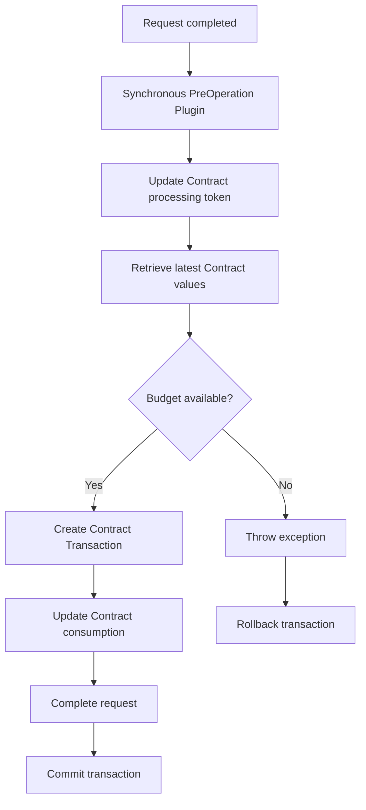

# Dataverse Contract Financial Transaction Processing

## 1. Overview

This solution implements a centralized financial transaction processing approach for a Contract Management solution built on Microsoft Dataverse and Power Platform.

The main objective is to ensure that multiple request types affecting the same Contract cannot independently read and update financial consumption using stale values.

The solution must ensure that:

- Contract budget validation uses the latest available consumption.
- Multiple requests affecting the same Contract are processed without creating inconsistent financial balances.
- A request cannot be completed if its financial impact exceeds the available Contract budget.
- Financial transaction creation and Contract consumption updates succeed or fail together.
- Requests affecting different Contracts can be processed independently.

## 2. Business scenario

Multiple request types can affect the financial consumption of a Contract.

Examples include:

- Order Request
- Amendment Request
- Reimbursement Request
- Cancellation Request

Each request can create a financial impact on the associated Contract.

For example:

| Description | Amount |
|---|---:|
| Contract budget | €100,000 |
| Current consumption | €70,000 |
| Order Request A | €20,000 |
| Order Request B | €15,000 |

If both requests are processed concurrently, they must not independently read the original consumption of €70,000 and both conclude that sufficient budget is available.

The expected behaviour is that the requests are processed against the latest Contract consumption.

## 3. Proposed architecture

The proposed solution uses synchronous Dataverse plug-ins to process financial transactions.

Each request type has its own plug-in registration, but all request-specific plug-ins delegate financial processing to shared business logic.

### Plug-in registration

Each relevant request table has a plug-in registered with the following configuration:

| Setting | Configuration |
|---|---|
| Message | Update |
| Stage | PreOperation |
| Execution mode | Synchronous |
| Filtering attributes | Status / Status Reason |
| Image | Pre Image |

The plug-in detects when a request transitions to Completed.

### Processing sequence

When a request is completed, the plug-in:

1. Retrieves the Contract associated with the request.
2. Updates a technical field on the Contract, such as `new_lastprocessingtoken`.
3. Retrieves the latest Contract consumption and budget.
4. Calculates the financial impact of the request.
5. Validates whether sufficient budget is available.
6. Creates a Contract Transaction ledger record.
7. Updates the Contract consumption.
8. Allows the original request update to complete.

The Contract update in step 2 is intended to create database write contention between transactions affecting the same Contract.

### Architecture diagram



## 4. Concurrency control approach

### Updating the Contract record

Instead of maintaining a separate processing-control table, the proposed implementation uses the Contract record itself as the shared record touched by every financial transaction.

For example:

```csharp
var contractLock = new Entity("new_contract", contractId);

contractLock["new_lastprocessingtoken"] =
    Guid.NewGuid().ToString();

service.Update(contractLock);
```

Every request affecting the same Contract performs this update before reading the Contract's financial values.

The intention is to create write contention on the same Contract record.

For example:

- Request A updates Contract A.
- Request B attempts to update Contract A.
- Request C updates Contract B.

Requests A and B contend on the same Contract record, whereas Request C operates on a different record.

**Important:** This is a database write-contention technique, not a formally documented Dataverse application-level mutex. The observed behaviour must be validated under concurrent load, including failure and timeout scenarios. Dataverse does not guarantee FIFO processing.

## 5. Transaction management

The financial operations must participate in the same Dataverse transaction.

The plug-in uses:

```csharp
context.IsInTransaction
```

to verify that it is executing within a Dataverse transaction.

Example:

```csharp
if (!context.IsInTransaction)
{
    throw new InvalidPluginExecutionException(
        "Financial processing must execute inside a Dataverse transaction."
    );
}
```

### Successful execution

If all operations succeed, Dataverse commits the transaction.

This includes:

- Contract processing-token update.
- Contract Transaction creation.
- Contract consumption update.
- Original request status update.

### Failed execution

If any operation fails, the plug-in throws an exception:

```csharp
throw new InvalidPluginExecutionException(
    "Unable to process the Contract financial transaction."
);
```

Dataverse rolls back the operations participating in the same transaction.

This prevents situations where a financial transaction is created but the Contract consumption is not updated, or vice versa.

## 6. Concurrency testing

A practical concurrency test was performed directly in Dataverse.

### Test setup

Two request types were created:

1. **Order Request** – normal synchronous plug-in.
2. **Order Request Delayed** – copy of the original plug-in, with an additional 30-second delay.

The delayed plug-in included:

```csharp
service.Update(contractLock);

// Temporary delay for concurrency testing
Thread.Sleep(30000);

// Continue financial processing
```

The delay was introduced to keep the synchronous transaction open long enough to observe the behaviour of other operations against the same Contract.

### Test execution

The following operations were tested:

1. Start processing an Order Request Delayed.
2. Allow its plug-in to update the Contract and enter the 30-second delay.
3. While the delayed plug-in is executing, attempt to:
   - Update the same Contract directly.
   - Complete a normal Order Request associated with the same Contract.
4. Observe the execution of the other operations.

### Observed results

The following behaviour was observed:

| Operation | Observed behaviour |
|---|---|
| Delayed Order Request | Executed for approximately 30 seconds |
| Direct update of the same Contract | Delayed until the delayed request finished |
| Normal Order Request affecting the same Contract | Delayed until the delayed request finished |
| Other operations against the same Contract | Delayed until the delayed request finished |

Once the delayed Order Request completed, the other operations also completed.

### Conclusion from the test

The test demonstrated that, in the tested Dataverse environment, updating the shared Contract record within the synchronous plug-in transaction caused other operations attempting to update that same Contract record to wait until the first transaction finished.

This is the desired behaviour for the proposed financial processing approach: competing operations affecting the same Contract should not proceed independently while another financial transaction is being processed.

**Scope of the finding:** This is an observed result from the concurrency test, not proof of a universal Dataverse locking guarantee. Further automated concurrent testing is required before relying on this behaviour for production financial controls.

## 7. Recommended implementation principles

- Use synchronous PreOperation plug-ins for financial processing.
- Centralize financial logic in shared C# business logic.
- Ensure all financial operations participate in the same Dataverse transaction.
- Retrieve Contract financial values after the shared-record update.
- Create an immutable financial transaction history through a ledger table.
- Prevent duplicate financial transactions using an alternate key or another idempotency mechanism.
- Restrict direct updates to Contract consumption.
- Use exceptions to trigger transaction rollback.
- Avoid external API calls and Power Automate flows in the critical financial transaction path.
- Keep plug-in execution short and avoid unnecessary database operations.

Power Automate can still be used after successful processing for notifications, document generation and external integrations.

## 8. Limitations and further testing

Before deploying this approach to production, the following scenarios should be tested:

- Two or more simultaneous requests affecting the same Contract.
- Simultaneous requests affecting different Contracts.
- A request failing after the ledger record has been created.
- A request failing after Contract consumption has been updated.
- Duplicate execution of the same request.
- Cancellation and reversal of previously completed requests.
- Database blocking, deadlocks and transaction timeouts.
- Updates to the Contract from other plug-ins, integrations and applications.

The 30-second delay is strictly a testing mechanism and must be removed from production code.

The locking behaviour should also be reassessed if the solution's concurrency requirements increase.

## 9. Final architecture decision

The current preferred approach is:

**Synchronous Dataverse plug-ins + shared Contract record write contention + centralized financial processing + Contract Transaction ledger.**

This approach keeps the financial processing inside Dataverse and provides immediate synchronous feedback to users.

It also avoids introducing an external queue or asynchronous processing mechanism for a scenario with relatively low expected concurrency (approximately 2–5 simultaneous requests per Contract).

Production adoption remains subject to successful concurrency and failure testing, as well as validation against Microsoft's supported Dataverse transaction behaviour.
